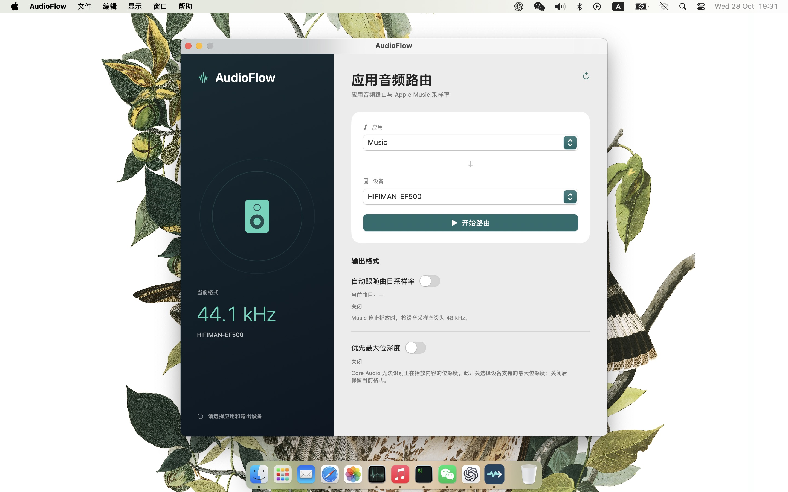
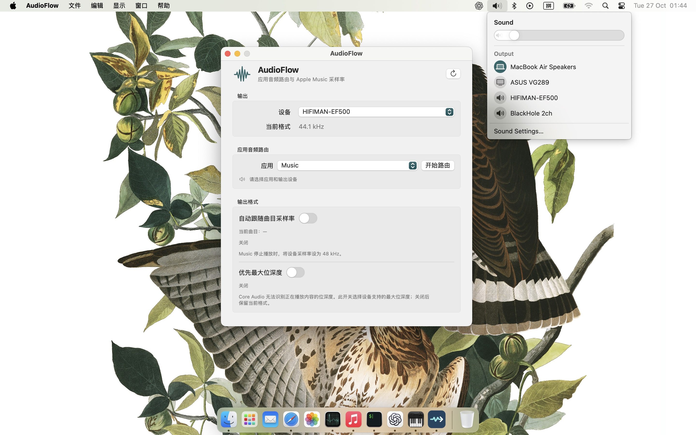

# AudioFlow

[English](#english) · [中文](#中文)

## English

AudioFlow is a native macOS app designed to **route only Apple Music audio to a chosen playback device**, while other system audio continues through a different device. This prevents sound from other apps and the system from mixing into the Apple Music playback device. AudioFlow can also match the device's sample rate to the Apple Music track and independently select its highest supported PCM bit depth.

### Screenshots




### How to use
1. In the macOS Sound menu or System Settings → Sound, set the **system default output** to another device, such as MacBook speakers. Do not select the DAC intended for Apple Music.
2. Open AudioFlow and choose the playback device for Apple Music under Output → Device, such as a USB DAC.
3. Select **Music** under App audio routing, then click Start routing. Music goes to the selected device; other apps continue using the system default output.
4. Optionally turn on Follow Apple Music track sample rate. AudioFlow will try to set the selected device to the current track's rate. It sets the device to 48 kHz when Music stops.
5. Optionally turn on Prefer maximum bit depth. This is independent of sample rate matching and selects the highest PCM bit depth the device supports at its current rate. Core Audio cannot detect the bit depth of the content being played, so this option does not follow each track's bit depth.

Download the macOS DMG from [Releases](../../releases), open it, and drag AudioFlow to Applications. The distributed app is ad hoc signed and not notarized; macOS may require you to allow it on first launch.

### Performance and notes

- The design target is low CPU usage: **under 5% of one CPU core combined** for AudioFlow and its routing helper during playback. Actual usage varies by Mac, device, and audio format; this figure has not been verified by a sustained benchmark.
- When routing and sample rate matching are both enabled, a rate change briefly restarts routing and may interrupt audio.
- First use may require System Audio Recording permission for routing and Automation permission to read Music track information.
- Routing uses a Core Audio process tap and PCM output, so strict bit-perfect playback is not guaranteed.
- The interface supports Simplified Chinese and English and follows the language selected for AudioFlow in macOS. Restart the app after changing its language.

To launch the installed app in Simplified Chinese for one session without changing macOS settings:

```sh
open -n -a /Applications/AudioFlow.app --args -AppleLanguages '(zh-Hans)'
```

### Build

Requires macOS 15 or later and the Swift 6 command line tools:

```sh
./build.sh
```

The built app is at `dist/AudioFlow.app`.

Licensed under [0BSD](LICENSE).

## 中文

AudioFlow 是一个原生 macOS 应用，主要用途是**只把 Apple Music 的声音路由到指定播放设备**，让系统其他声音继续从另一个设备播放。这样可以防止其他应用和系统声音混入 Apple Music 的目标播放设备。它还可以跟随 Apple Music 曲目的采样率调整播放设备，并可独立选择设备支持的最大 PCM 位深度。

### 使用方法

1. 在 macOS 的声音菜单或“系统设置 → 声音”中，把**系统默认输出**设为其他设备，例如 MacBook 扬声器。不要选 Apple Music 要使用的 DAC。
2. 打开 AudioFlow，在“输出 → 设备”中选择 Apple Music 要使用的播放设备，例如 USB DAC。
3. 在“应用音频路由”中选择 **Music**，点击“开始路由”。这时只有 Music 的声音被送往所选设备；其他应用仍使用系统默认输出。
4. 按需开启“自动跟随曲目采样率”。开启后，AudioFlow 会尝试把所选设备设为当前 Apple Music 曲目的采样率；Music 停止播放时设为 48 kHz。
5. 按需开启“优先最大位深度”。此选项独立于采样率跟随，只选择设备当前采样率下支持的最高 PCM 位深度。Core Audio 无法识别正在播放内容的位深度，因此这不是按曲目位深度自动切换。

可从 [Releases](../../releases) 下载 macOS DMG，打开后将 AudioFlow 拖入“应用程序”。发布版使用临时签名，未经 Apple 公证；首次启动时 macOS 可能要求手动允许。

### 性能与注意事项

- 设计目标是低 CPU 占用：播放时 AudioFlow 与路由组件合计**低于单个 CPU 核心的 5%**。实际占用会随 Mac、设备和音频格式变化；此数值尚未作为持续测试结果验证。
- 同时使用路由和采样率跟随时，变更设备采样率会短暂重启路由，声音可能短暂中断。
- 首次路由可能需要授予“屏幕与系统音频录制”权限；读取 Music 曲目可能需要授予“自动化”权限。
- 路由通过 Core Audio 进程 tap 和 PCM 输出实现，不保证严格意义上的 bit-perfect。
- 界面提供简体中文和英文，跟随 macOS 为 AudioFlow 选定的语言；更改语言后需重启应用。

若只想让本次启动使用简体中文，而不更改 macOS 设置：

```sh
open -n -a /Applications/AudioFlow.app --args -AppleLanguages '(zh-Hans)'
```

### 构建

需要 macOS 15 或更新版本，以及 Swift 6 命令行工具：

```sh
./build.sh
```

构建结果位于 `dist/AudioFlow.app`。

采用 [0BSD](LICENSE) 许可证。
